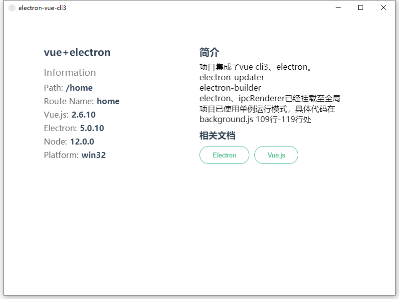

# electron-vue-cli3

一个面向桌面应用开发的 Electron + Vue 3 + TypeScript + Vite 示例项目。项目展示了 Electron 主进程、preload 和 renderer 之间的安全边界，并提供窗口管理、IPC、系统通知、系统信息和自动更新等基础能力。



## 功能

- 使用 Vue 3、Vue Router 5、TypeScript 和 Vite 构建渲染进程。
- 使用 `electron-vite` 分别构建 main、preload 和 renderer。
- preload 通过 `contextBridge` 暴露经过类型约束的最小 API。
- BrowserWindow 默认启用 `contextIsolation`、`sandbox`，并关闭 `nodeIntegration`。
- 支持打开外部 HTTP/HTTPS 链接、系统通知和读取运行时信息。
- 使用 `electron-updater` 检查、下载和安装更新。
- 使用 Oxfmt 格式化 JavaScript、TypeScript、Vue 和样式文件。
- 使用 OxLint 检查非 Vue JavaScript/TypeScript 文件，使用 ESLint 和 `eslint-plugin-vue` 检查 Vue 单文件组件。

## 环境要求

- Node.js 24（项目根目录的 `.nvmrc` 记录当前开发版本）；Node.js 22 及以上版本满足项目声明的最低要求。
- npm。
- macOS、Windows 或 Linux。项目当前主要在 macOS arm64 环境验证，其他平台的安装包和原生依赖需要单独验证。

如果使用 nvm，可以执行：

```bash
nvm install
nvm use
```

## 安装

```bash
git clone git@github.com:zjinh/electron-vue-cli3.git
cd electron-vue-cli3
npm install
```

`npm install` 会执行 `electron-builder install-app-deps`，用于安装和重建 Electron 原生依赖。

## 开发

启动 Electron 开发模式：

```bash
npm run dev
```

只启动 renderer 的 Vite Web 开发服务器：

```bash
npm run dev:web
```

`dev:web` 适合单独调试 Vue 页面；窗口、IPC、通知和自动更新等 Electron 能力需要通过 `npm run dev` 验证。

## 检查与格式化

```bash
# TypeScript/Vue 类型检查
npm run typecheck

# OxLint 检查非 Vue 文件，ESLint 检查 Vue 单文件组件
npm run lint

# 格式化项目文件
npm run format

# 只检查格式，不修改文件
npm run format:check
```

Oxfmt 支持 Vue 文件格式化。OxLint 对 `.vue` 文件目前只检查 `<script>` 块，不检查 `<template>`，因此 Vue 文件由 ESLint 的 `eslint-plugin-vue` 负责模板规则。

## 构建

构建 Web renderer：

```bash
npm run build:web
```

执行完整检查、Electron 构建和安装包打包：

```bash
npm run build
```

构建流程包括：

1. `vue-tsc` 类型检查。
2. OxLint 和 ESLint 检查。
3. `electron-vite build` 构建 main、preload 和 renderer。
4. `electron-builder` 根据 `electron-builder.ts` 生成安装包。

构建目录如下：

- `out/`：Electron main、preload 和 renderer 的构建结果。
- `build/`：electron-builder 生成的安装包和应用目录。
- `dist/`：单独执行 `npm run build:web` 时的 renderer 构建结果。

## 自动更新

应用通过 renderer 暴露的 typed API 请求更新检查：

```ts
window.electronAPI.updater.check('https://example.com/releases/')
```

当前实现使用 `electron-updater` 的 generic provider。传入的地址需要指向可用的更新源；生产环境发布前还需要配置对应平台的更新元数据、安装包和发布地址。

## 项目结构

```text
src/
├── main/       # Electron 主进程、窗口、IPC、通知和更新
├── preload/    # contextBridge 和 renderer 可调用的安全 API
├── renderer/   # Vue 页面、路由、组件和样式
└── shared/     # main、preload、renderer 共用的 TypeScript 类型
public/         # 图标和静态资源
electron.vite.config.ts
electron-builder.ts
vite.config.ts
```

新增 IPC 能力时，请同时更新 `src/shared/electron-api.ts`、preload API 和 main 进程的 handler，避免 renderer 直接访问 Node.js 或 Electron 内部 API。

## 贡献

欢迎通过 GitHub Issues 反馈问题，或提交 Pull Request：

1. Fork 仓库并创建功能分支。
2. 保持改动范围清晰，并补充必要的类型或文档更新。
3. 提交前运行 `npm run typecheck`、`npm run lint` 和 `npm run format:check`。
4. 在 Pull Request 中说明改动内容、验证方式和适用平台。

仓库地址：[github.com/zjinh/electron-vue-cli3](https://github.com/zjinh/electron-vue-cli3)。

## 许可证

当前仓库尚未包含 `LICENSE` 文件。正式对外发布或接受外部贡献前，请根据项目维护者的选择补充明确的开源许可证。
